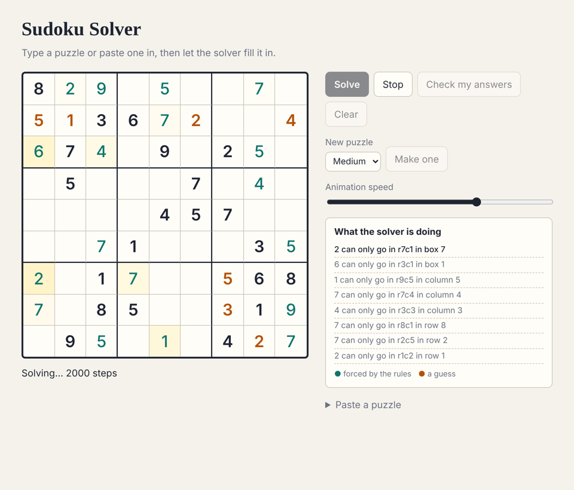
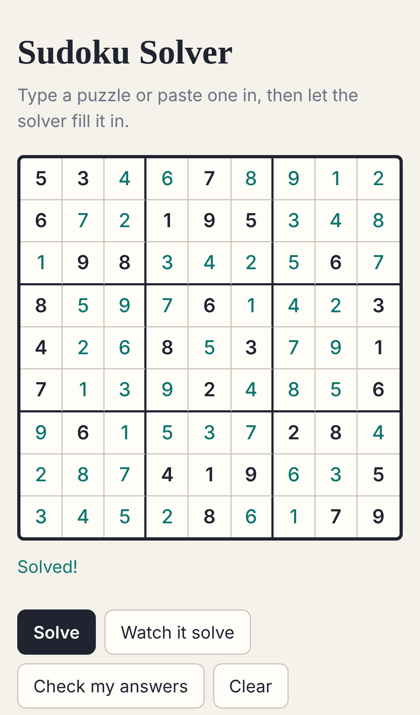

# Sudoku Solver

**▶ [Try it](https://theoyanvno.github.io/sudoku-solver/)**

A Sudoku solver that shows its work. Type or paste a puzzle and solve it instantly, or press **Watch it solve** to see every step with a plain-English reason ("8 can only go in r6c2 in box 4"), including the guesses and the backtracks when a guess turns out wrong. It also makes new puzzles at three difficulty levels.

**Tech:** vanilla JavaScript (ES modules) · HTML/CSS · `node:test` · no frameworks or build step

| Watching it solve a hard puzzle | On a phone |
|---|---|
|  |  |

## Features

- **Solve** any valid puzzle in a few milliseconds, with stats: cells filled by logic, guesses and backtracks
- **Watch it solve:** replays each step with an adjustable speed; logic steps are green, guesses orange, and undone guesses are logged in red
- **Validation** with clear messages: duplicate digits in a row, column or box (highlighted as you type), too few clues, or no possible solution
- **New puzzle** (easy, medium or hard), always with exactly one solution
- **Check my answers** underlines wrong entries without giving the answers away
- Paste a puzzle as 81 characters, or share one in the URL: `…/sudoku-solver/#53..7....6..195…`
- Keyboard friendly: arrow keys move between cells; works on phones with the number keypad
- Light and dark themes follow your system setting

## How the solver works

All the logic is in [`src/sudoku.js`](src/sudoku.js), with no browser code.

1. **Candidates as bitmasks.** Each empty cell keeps a 9-bit number of the digits that could still go there. Placing a digit clears that bit from the cell's 20 peers (same row, column and box), which is fast and simple.
2. **Constraint propagation.** Before any guessing, it repeats two rules until nothing changes:
   - *Only one fits:* a cell with a single candidate gets that digit.
   - *Only one spot:* a digit that fits in just one cell of a row, column or box goes there.

   Easy puzzles are fully solved by these two rules.
3. **Backtracking search.** When the rules get stuck, it picks the empty cell with the fewest candidates (the best odds), tries each one on a copy of the board, and propagates again. A contradiction (a cell with no candidates, or a digit with nowhere to go) means the guess was wrong, so it goes back and tries the next digit.

`countSolutions()` uses the same search but keeps going after the first answer, stopping at 2. That is how the generator checks a puzzle is unique.

## How puzzles are made

[`src/generator.js`](src/generator.js):

1. Solve an empty grid while trying digits in random order, which gives a random finished grid.
2. Remove clues one at a time in random order. If removing a clue allows a second solution, put it back.
3. Grade the result: easy and medium puzzles must be solvable by logic alone (medium has fewer clues); hard puzzles need at least one guess.

A seeded random number generator (mulberry32) makes puzzles repeatable, which keeps the tests stable.

## Run it

No install needed. Serve the folder (ES modules don't load from `file://`):

```bash
npm start      # python3 -m http.server 8000, then open http://localhost:8000
npm test       # 18 tests (Node 18+)
```

| File | What it does |
|---|---|
| `src/sudoku.js` | Parsing, validation, propagation, backtracking, solution counting |
| `src/generator.js` | Random grids, removing clues, difficulty grading |
| `src/app.js` | The grid, buttons, animation and step log |
| `test/` | Solver and generator tests |

Built with help from AI coding tools for planning, code review and tests.
